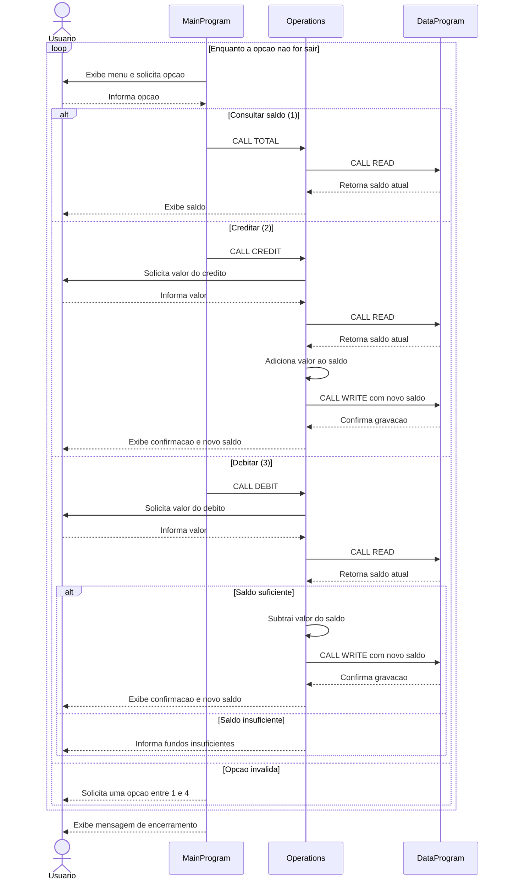

# Documentacao do sistema COBOL

Este diretorio descreve os programas COBOL do sistema de gerenciamento de contas. Os fontes estao em `src/cobol/`.

## Arquivos

### `main.cob` - `MainProgram`

Ponto de entrada e interface de linha de comando. Exibe o menu, le a escolha do usuario e encaminha as operacoes para `Operations`:

- `1`: consulta o saldo (`TOTAL `).
- `2`: credita um valor (`CREDIT`).
- `3`: debita um valor (`DEBIT `).
- `4`: encerra o programa.

Escolhas fora de 1 a 4 exibem uma mensagem de erro e o menu e apresentado novamente.

### `operations.cob` - `Operations`

Implementa as operacoes da conta. Recebe o tipo de operacao de `MainProgram` e coordena a leitura ou atualizacao do saldo por meio de `DataProgram`.

- `TOTAL `: le e exibe o saldo atual.
- `CREDIT`: solicita um valor, le o saldo, adiciona o valor, grava o novo saldo e o exibe.
- `DEBIT `: solicita um valor e le o saldo. Se houver saldo suficiente, subtrai e grava o novo saldo; caso contrario, informa que os fundos sao insuficientes.

### `data.cob` - `DataProgram`

Mantem o saldo em `STORAGE-BALANCE`, inicializado em `1000.00`. Recebe uma acao e o campo do saldo por linkage:

- `READ`: copia o saldo armazenado para o campo recebido.
- `WRITE`: copia o saldo recebido para o armazenamento.

## Regras de negocio

- O saldo inicial e `1000.00`.
- Um debito so e realizado quando o saldo e maior ou igual ao valor solicitado; caso contrario, a conta permanece sem alteracao.
- Creditos sao adicionados ao saldo atual.
- O codigo nao implementa regras especificas para contas de estudante. Nao ha identificacao de estudante, limite especial, tarifa, juros ou restricao de operacao por tipo de conta nos fontes atuais.
- Os valores sao recebidos em campos numericos COBOL com duas casas decimais implicitas (`PIC 9(6)V99`). Nao ha validacao explicita de limites ou de valores de negocio antes de creditar ou debitar.

## Fluxo entre programas

`MainProgram` recebe a escolha, chama `Operations` para executar a acao, e `Operations` chama `DataProgram` para ler ou gravar o saldo. O armazenamento pertence a `DataProgram` durante a execucao do programa.

## Diagrama de sequencia

